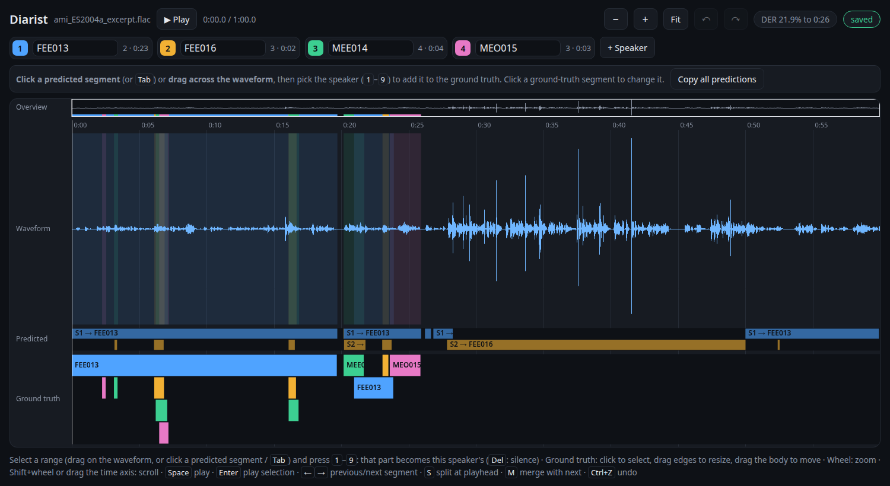

# Diarist

Label ground truth for speaker diarization ("who speaks when") in the browser.

Diarist shows an audio file on a zoomable timeline with its waveform. You mark speech segments and assign them to
speakers. Every change is saved straight away as audformat CSV, RTTM and Praat TextGrid.
If you have a [Hugging Face](https://huggingface.co) token, [pyannote](https://github.com/pyannote/pyannote-audio)
predicts the speakers first. Its segments are shown as a reference you can click, copy and correct, and the view shows
their diarization error rate (DER) on the part you have labelled so far.



## Installation

Python 3.12 or newer and a browser (Chrome or Firefox):

```bash
git clone https://github.com/felixbur/diarist.git && cd diarist
uv venv --python 3.12 .venv && source .venv/bin/activate   # or: python -m venv .venv
uv pip install -e .                                         # or: pip install -e .
```

### Predictions with pyannote (optional)

Without a token, diarist starts with no predictions and you label from scratch.
To get predictions:

1. Log in on [huggingface.co](https://huggingface.co) and accept the conditions of
   [pyannote/speaker-diarization-community-1](https://huggingface.co/pyannote/speaker-diarization-community-1)
   (or of the pipeline set in `prediction.model`).
2. Create an access token (Settings > Access Tokens, read access).
3. Give it to diarist in one of three ways, in this order of precedence. First, a configuration file used with
   `--config`:

   ```yaml
   # my.local.yaml (*.local.yaml is ignored by git)
   prediction:
     hf_token: hf_...
   ```

   Second, the environment variable `HF_TOKEN`:

   ```bash
   export HF_TOKEN=hf_...
   ```

   Third, the token stored by the Hugging Face CLI (in `~/.cache/huggingface/token`):

   ```bash
   uvx --from huggingface_hub hf auth login
   ```

   Keep a file containing a token private and don't commit it.
4. Install [uv](https://docs.astral.sh/uv/). pyannote needs torch, so it runs in its own environment, which
   `uv run --script` creates on first use (several GB, see `diarist/model/pyannote_run.py`). If you already have an
   environment with `pyannote.audio` 4, set `prediction.command: [/path/to/that/python]` instead.

pyannote uses the GPU if there is one, otherwise the CPU (slower than real time on a laptop CPU).
Results are cached per audio file and settings in `~/.cache/diarist/pyannote`.

## Usage

To try it, the repository comes with a one-minute meeting excerpt with four speakers and a reference annotation
(from the AMI Meeting Corpus, CC BY 4.0, see [examples/](examples/)):

```bash
diarist examples/ami_ES2004a_excerpt.flac
diarist-der examples/ami_ES2004a_excerpt.rttm --pyannote   # how well pyannote does on it
```

In general:

```bash
diarist speech.wav                  # predict speakers, then annotate in the browser (http://localhost:8001)
diarist speech.wav --speakers 2     # fixed number of predicted speakers
diarist speech.wav --no-predictions # annotate without predictions
diarist speech.wav --repredict      # predict again, even with unchanged settings
diarist speech.wav --restart        # discard the annotation and start again with an empty one
diarist speech.wav --out my/folder  # annotation folder (default: annotations/<audio name>)
diarist speech.wav --config my.yaml # override parts of diarist/default_config.yaml
diarist speech.wav --host 0.0.0.0 --port 8080 --no-browser   # on a server, view from another machine
```

Starting again with the same file continues the stored annotation. Predictions are stored with their settings
(`predictions.yaml`). When the settings change (e.g. `prediction.model` or `--speakers`), the next start predicts
again and keeps the ground truth. Any format `soundfile` reads works.

## The view

From top to bottom: an overview of the whole file (click or drag to navigate), the time axis (drag to scroll), the
waveform, the predicted speakers (read only) and the editable ground truth.

* **Speakers** (chips at the top): the predicted speakers `S1`, `S2`, ... Type a name to rename one; typing the name
  of another speaker merges the two. **+ Speaker** adds a speaker, and a speaker without segments can be removed.
* **Label**: select a range (drag across the waveform, or click a predicted segment, `Tab` / `Shift+Tab` for the
  next / previous one), then press `1`–`9` or click a speaker button. That part of the ground truth becomes this
  speaker's, and whatever was there before is cut away. `Del` makes the range silence. `A` adds it as an
  overlapping segment and keeps what is there (overlapping speech is drawn in separate rows).
* **Copy all predictions** (shown while nothing is selected) fills the ground truth with the predictions, so you can
  correct them instead of labelling from scratch.
* **Correct**: click a ground-truth segment (or the waveform at its time) to select it, then pick another speaker the
  same way. Drag its edges to change its boundaries, drag its body to move it, or drag on empty space of the
  ground-truth lane to draw a new segment. `S` splits the selected segment at the playhead, `M` merges it with the
  next one, and `Del` deletes it.
* **Playback**: click the waveform to place the playhead. `Space` plays / pauses, `Enter` plays the selected segment
  or range.
* **Zoom**: mouse wheel (around the pointer), `+` / `-`, or `0` / **Fit** for the whole file. `Shift`+wheel scrolls.
  `Ctrl+Z` / `Ctrl+Shift+Z` undo / redo.

Every change is saved immediately; the pill at the top right shows the save state. Next to it is the DER of the
predictions on the part labelled so far (hover for its components).

## Output

`annotations/<audio name>/` contains

* `annotation.json`: the annotation as edited (speakers with ids and names, segments), loaded again on the next start
* `ground_truth.csv`, `ground_truth.rttm`, `ground_truth.TextGrid` (one tier per speaker): the ground truth with
  speaker names, rewritten on every save
* `predictions.csv`, `predictions.yaml`: the predicted segments (audformat, `file, start, end` index, `speaker`
  column) and the settings they were made with. The token is never stored here.

## Evaluation

```bash
diarist-der annotations/speech                    # DER of the predictions against the ground truth
diarist-der ground_truth.rttm my_system.rttm      # any RTTM or audformat CSV files
diarist-der truth.csv my_system.csv --pyannote --audio-root /data/audio   # add pyannote for comparison
```

computes the diarization error rate with [audmetric](https://github.com/audeering/audmetric) (confusion, false
alarm, missed speech per file and in total).

## Documentation

Full documentation (installation, usage, configuration, output, architecture, API) is in [docs/](docs/), built with
Sphinx: `uv pip install -e ".[docs]" && python -m sphinx docs build/html`.

## Development

MVC layout: `diarist/model` (pyannote predictions), `diarist/controller` (annotation data model, storage and exports,
audio / waveform, DER), `diarist/view` (HTML/JS) and `diarist/server.py` (FastAPI).

```bash
uv pip install -e ".[dev]" && python -m pytest
```

The tests replace pyannote with a stand-in script, so they need neither a token nor torch.

## License

MIT, see [LICENSE](LICENSE). The example audio and its annotation in [examples/](examples/) are from the
AMI Meeting Corpus and licensed under CC BY 4.0.
