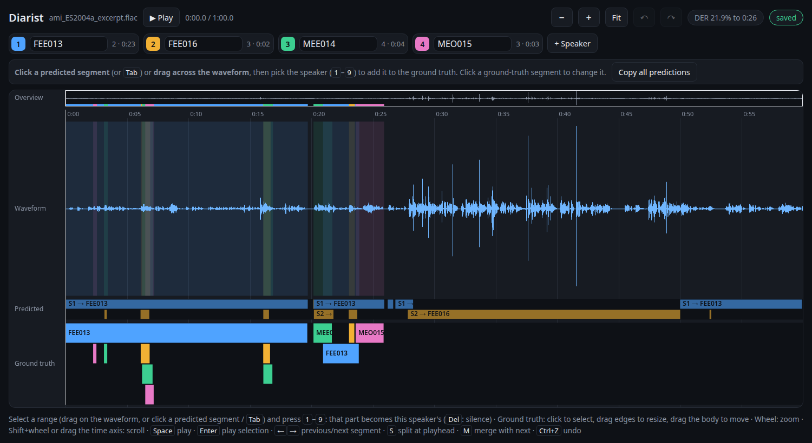

Diarist
=======

Manual labelling of ground truth for speaker diarization ("who speaks when").
Diarist shows an audio file on a zoomable timeline in the browser,
where the ground truth is labelled speaker by speaker.
With a Hugging Face token, `pyannote <https://github.com/pyannote/pyannote-audio>`_
predicts the speakers first, as a guide that can be copied and corrected.
The ground truth is stored as audformat table, RTTM and Praat TextGrid.

    The view while labelling the example meeting: pyannote predicted two speakers (S1, S2),
    renamed to the participants they turned out to be; the ground truth of the first 26 s
    is done, with short overlapping remarks of the others in further rows,
    and the pill at the top shows the diarization error rate of the predictions so far.

.. code-block:: bash

    $ diarist speech.wav

predicts the speakers (if there is a token) and opens the view in the browser.
See :doc:`installation` and :doc:`usage`.

.. toctree::
    :caption: Getting started
    :maxdepth: 2
    :hidden:

    installation
    usage
    cli
    configuration
    output
    evaluation

.. toctree::
    :caption: Design
    :maxdepth: 2
    :hidden:

    architecture

.. toctree::
    :caption: API Documentation
    :maxdepth: 2
    :hidden:

    api

.. toctree::
    :caption: Development
    :maxdepth: 2
    :hidden:

    development
    changelog
