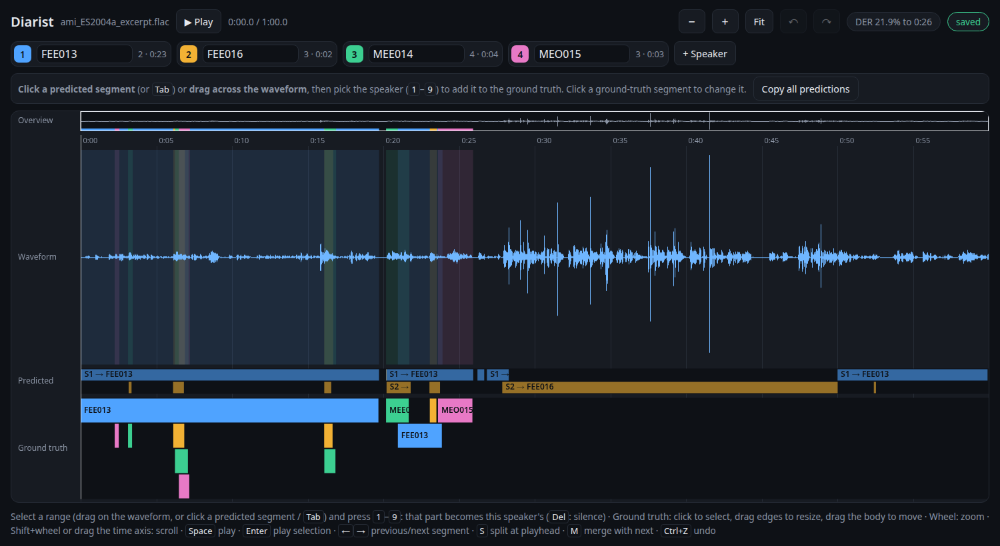

Usage
=====

Starting
--------

The repository comes with an example, a one-minute excerpt of a meeting with four speakers
from the AMI Meeting Corpus (CC BY 4.0, see ``examples/README.md``):

.. code-block:: bash

    $ diarist examples/ami_ES2004a_excerpt.flac

In general:

.. code-block:: bash

    $ diarist speech.wav

predicts the speakers with pyannote if there is a Hugging Face token
(see :doc:`installation`), stores the predictions and opens the view in the browser::

    Annotate speech.wav at http://localhost:8001
    Ground truth in annotations/speech

Stop the server with :kbd:`Ctrl+C`. Starting again with the same file
continues the stored annotation.

The annotation folder is found next to the audio if it is there: the audio's own folder
(``data/speech/speech.wav`` with ``data/speech/annotation.json``) or a folder of its name
beside it (``data/speech.wav`` with ``data/speech/``). Otherwise it is
``annotations/<audio name>`` (``storage.root``); ``--out`` chooses another one.

Command line options
--------------------

.. code-block:: bash

    $ diarist speech.wav --speakers 2      # fixed number of predicted speakers (default: detect)
    $ diarist speech.wav --repredict       # predict again, even with unchanged settings
    $ diarist speech.wav --restart         # discard the annotation, start again with an empty one
    $ diarist speech.wav --out my/folder   # annotation folder (default: annotations/<audio name>)
    $ diarist speech.wav --no-predictions  # annotate without predictions
    $ diarist speech.wav --config my.yaml  # override parts of the configuration
    $ diarist speech.wav --no-browser      # only print the address
    $ diarist speech.wav --host 0.0.0.0 --port 8080  # serve on another address

Any format :mod:`soundfile` reads works; formats browsers cannot play
are converted to ``playback.wav`` in the annotation folder.

Predictions
-----------

With a Hugging Face token, the pyannote pipeline of ``prediction.model``
predicts the speakers of the whole file; they are named ``S1``, ``S2``, ...
in order of appearance. Overlapping speech gets several speakers.
``--speakers`` (or ``prediction.num_speakers``, ``min_speakers``, ``max_speakers``)
tells pyannote how many speakers to expect.

The predictions are stored with their settings and reused on the next start;
when the settings change (see :doc:`configuration`), the speakers
are predicted again. New predicted speakers are added to the annotation's speakers,
the ground truth is kept. Without a token, stored predictions are still shown,
and if there are none, diarist starts without predictions:
the predicted lane is empty, and the speakers are added with **+ Speaker**.

The ground truth starts empty; the predicted speakers are the initial speaker list.
**Copy all predictions** fills it with the predictions, consecutive segments
of a speaker less than ``view.merge_gap`` seconds apart joined.

The view
--------

    Labelling the example meeting: the ground truth of the first 26 s is done,
    pyannote's speakers S1 and S2 are renamed, two more speakers were added.

From top to bottom:

Overview
    the whole file with the ground-truth speakers; the frame marks the visible part.
    Click or drag to navigate.
Time axis
    drag to scroll.
Waveform
    click to place the playhead, drag to select a range.
Predicted
    the model's speakers, read only; ``S1 → Alice`` shows a renamed speaker.
    Click a segment to select its range. Overlapping speech predicted with several
    speakers is drawn in further rows.
Ground truth
    the annotation being edited. Overlapping segments (overlapping speech)
    are drawn in separate rows.

Speakers
    The chips above the timeline list the speakers with their key, number of
    segments and total duration. Type in a chip to rename the speaker;
    typing the name of another speaker merges both (after a confirmation).
    **+ Speaker** adds one; a speaker without segments can be removed with ✕.
    Clicking a chip assigns the speaker to the selected segment,
    without a selection it becomes the speaker for new segments.

Labelling
    Select a range: drag across the waveform, or click a predicted segment
    (:kbd:`Tab` / :kbd:`Shift+Tab` for the next / previous one).
    Then press :kbd:`1` – :kbd:`9`, click a speaker button in the bar or a chip:
    that part of the ground truth becomes this speaker's, whatever was
    there before is cut away. **Silence** (:kbd:`Del`) removes the ground truth in the range,
    **Add overlapping** (:kbd:`A`) adds a segment and keeps what is there.
    While nothing is selected, **Copy all predictions** fills the ground truth
    with the predictions, to correct them instead of labelling from scratch.

Correcting
    Click a ground-truth segment (or the waveform at its time) to select it,
    then choose another speaker the same way.
    Drag the edges of a segment to change its boundaries, drag its body to move it,
    drag on empty space of the ground-truth lane to draw a new one.

Every change is saved immediately; the pill at the top right shows
``saved``, ``unsaved`` or ``save failed`` (hover for the error).

The pill next to it shows the diarization error rate of the predictions
on the part labelled so far, e.g. ``DER 13.2% to 0:19``: only the time up to the
end of the last ground-truth segment is scored, so a partly labelled file is
not dominated by false alarms. Hover for confusion, false alarm and missed speech.
Without predictions it is not shown.
See :doc:`evaluation` for the DER of finished annotations.

Keys
----

=============================  ===============================================
:kbd:`Space`                   play / pause from the playhead
:kbd:`Enter`                   play the selected segment or range
:kbd:`Tab` / :kbd:`Shift+Tab`  select the next / previous predicted segment
:kbd:`1` – :kbd:`9`            speaker of the selected range or segment
:kbd:`←` / :kbd:`→`            previous / next segment
:kbd:`Shift+←` / :kbd:`→`      playhead 1 s back / forward
:kbd:`S`                       split the selected segment at the playhead
:kbd:`M`                       merge the selected segment with the next one
:kbd:`Del`                     delete the selected segment, or make the range silence
:kbd:`A`                       add the selected range as overlapping segment
:kbd:`+` / :kbd:`-`            zoom in / out (mouse wheel: around the pointer)
:kbd:`0` or :kbd:`F`           show the whole file
:kbd:`Shift` + wheel           scroll
:kbd:`Ctrl+Z`                  undo
:kbd:`Ctrl+Shift+Z`            redo
:kbd:`Esc`                     clear the selection
=============================  ===============================================
